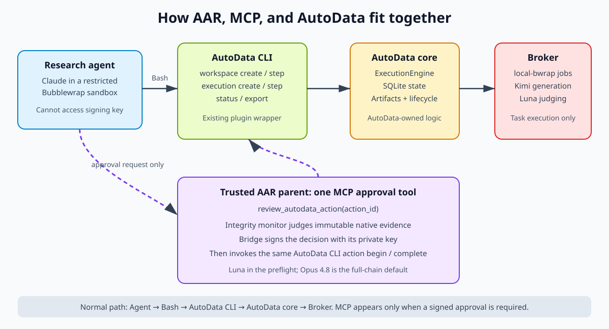

# Run 9 implementation changes

This log records meaningful implementation changes made while stabilizing Run 9.
Each entry identifies the observed problem, root cause, fix, validation, measured
effect, and source-control provenance. Run outputs and transient endpoint details
remain outside Git.

## Reduce repeated AutoData task-state writes

### Problem

During baseline generation, individual broker jobs normally completed in about
7–12 seconds (median approximately 9.1 seconds), but AutoData ingested completed
results much more slowly. Iteration 0 could remain active for tens of minutes,
with observed end-to-end ingestion near one result per minute despite 16-way
concurrency.

The broker was not the bottleneck. AutoData's `ExecutionEngine._wait` loop polled
each active task approximately every 200 milliseconds and called
`update_task_attempt` on every poll, even when the task remained in the same
state. At 16 concurrent tasks this could cause roughly 80 redundant SQLite
update attempts per second. The run's AutoData state database was on network
storage, making SQLite locking and filesystem synchronization unusually costly.
Repeated control-plane reads for wall-budget and cancellation checks added more
database traffic on the same polling path.

### Fix

The native AutoData execution engine now:

- remembers the last observed executor status and writes task state only when
  that status changes;
- continues polling the executor so terminal results are detected promptly;
- checks wall budget, cancellation state, and progress every two seconds rather
  than on every 200-millisecond executor poll; and
- preserves the existing terminal-state, cancellation, and error behavior.

No broker implementation or job-execution semantics were changed. This is a
control-plane persistence optimization inside AutoData.

### Validation and measured effect

- Added regression coverage in `tests/test_engine.py` for unchanged-state
  polling and state transitions.
- The AutoData test suite passed on the combined stabilized revision: 75 passed
  and 1 skipped.
- Broker jobs continued to complete in approximately 7–12 seconds.
- The new native lifecycle preflight initially ingested about 24 results per
  minute, compared with approximately one result per minute in the affected
  run. This is an observed run-specific improvement, not a general throughput
  guarantee.
- No result corruption was observed before or after the fix. The original
  failure mode was excessive latency, delayed batch replenishment, and poor
  utilization of configured concurrency.

### Provenance

- Repository: `autodata_pipelines`
- Core fix: `10c6d5e75c7753fd55fa7fbb68b32b389e103f47`
  (`Engine: avoid repeated task-state writes`)
- Bundled plugin wheel update: `559c4a9`
- The commits were synchronized to the FAIR HPC AutoData checkout used by the
  Run 9 preflight.

## Switch trusted question-only generation from Firecracker to local Bubblewrap

### Why Firecracker was selected initially

Firecracker itself is a lightweight micro-VM technology, not an AutoData
invention. AutoData provides a broker runner that obtains a SandoQ Firecracker
lease, pulls and verifies a digest-pinned OCI image, runs the declared phases,
returns only allowlisted results, and releases the VM. This is AutoData's
prominent general-purpose execution path and provides strong isolation for
arbitrary code, OCI-dependent environments, and sealed-test verification.

Starting with Firecracker was therefore a conservative security choice.
However, Run 9 data generation is a fixed, operator-reviewed, question-only
Python recipe. It makes Kimi generation and Luna judging calls, writes one
declared result, and does not need an arbitrary OCI environment, hidden inputs,
or a verifier phase. Firecracker's stronger VM boundary added machinery that
this workload did not use.

AutoData already documents a more specific fit in
`docs/firecracker-broker.md` under **Trusted question-only local runner**. That
runner preserves the broker boundary while executing each solve phase in a
local Bubblewrap process sandbox.

### Observed Firecracker bottleneck

Every simultaneous Firecracker task required a separate lease from a finite
SandoQ warm pool:

```text
16 requested tasks
  → 16 Firecracker VM leases required
  → warm pool has fewer available VMs
  → HTTP 429, lease waiting, or timeout
```

The retained capacity probes showed:

- `oci-runner-firecracker-small` repeatedly had no available pod;
- `medium` admitted only three of four concurrent sessions before its fourth
  request exhausted the bounded lease wait; and
- `large` admitted four sessions in one canary, but a subsequent real attempt
  still encountered pool-exhaustion HTTP 429 responses at concurrency four.

Live events from the retained Firecracker attempt showed a median broker-task
duration of approximately 37 seconds: 19 seconds leasing a VM, 5 seconds
preparing it, and only about 9 seconds in the Kimi-plus-Luna solve. Firecracker
therefore spent substantially more time provisioning the execution boundary
than performing the actual Run 9 work.

### Change

Run 9 now selects AutoData's existing `local-bwrap` broker runner on a dedicated
CPU Slurm allocation:

```text
One CPU Slurm allocation
  → one authenticated loopback AutoData broker
  → up to 16 local Bubblewrap task sandboxes
  → Kimi generation and Luna judging
```

The broker implementation was not replaced or forked for this change. It still
owns the attempt-scoped authentication capability, model credential injection,
campaign cost reservations, idempotency ledger, result allowlist, and output
secret scan. AutoData still owns corpus fan-out, budgets, retries, candidate
history, meta-optimization, and comparison policy.

Bubblewrap removes the external VM-lease pool and the per-task VM/image
preparation path. The switch therefore removes these failure and latency
sources:

- SandoQ warm-pool dependence;
- lease HTTP 429 responses and lease timeouts;
- VM startup, renewal, release, and ambiguous disconnects;
- per-task OCI image preparation; and
- Firecracker gateway, registry, and token dependencies that a question-only
  task does not require.

### Internal model routing

The first local-runner probes correctly removed inherited proxy variables but
then showed that the external inference-gateway hostname was not reachable from
the HPC task environment. Those attempts failed before reaching Kimi and
recorded no provider usage.

The route changed from the external HTTPS ingress:

```text
https://ram-inference-gateway.ingress.fair-cw-use2-1.cw.metafb.cloud/v1
```

to the cluster-internal Slurm ingress:

```text
http://fair-cw-use2-1-ingress-slurm-ingress/v1
Host: ram-inference-gateway.ingress.
```

The campaign policy still pins and passes the same model and deployment headers,
so the generator remains `Kimi-K2.6` on deployment `winnieyangwn-kimi26`. Only
the path from the compute node to the inference gateway changed.

This restored model connectivity without reintroducing inherited proxy
variables into the task sandbox. It also removes external DNS, TLS, proxy, and
egress dependencies from this local cluster path. The corrected concurrency-16
canary reached Kimi and Luna for all 16 jobs. This change does not add Kimi
replicas, distribute the endpoint across more nodes, or by itself raise model
serving capacity; any higher request concurrency still requires a load test.

### Node-local broker ledger

The broker's hot SQLite idempotency ledger now lives under the compute node's
`$SLURM_TMPDIR` rather than inside the retained network-filesystem directory.
Uploads and declared results remain on retained storage, and clean shutdown
checkpoints and copies a broker-database snapshot into the attempt directory.

This follows the AutoData broker runbook for a network-backed broker root. It is
separate from the AutoData `ExecutionEngine` SQLite fix above: the engine fix
reduces repeated writes to native lifecycle state, while node-local placement
keeps the broker's distinct job ledger away from network-filesystem lock and
WAL latency.

Without this placement, a low-load run might still work, but concurrent broker
state transitions are more likely to suffer slow locking, delayed idempotency
lookups, write timeouts, or misleading broker stalls. The node-local ledger is
therefore stability hardening rather than a change to job semantics.

### Validation and measured effect

- The corrected concurrency-16 local canary completed in 2 minutes 3 seconds.
  All 16 broker jobs and task envelopes succeeded and recorded both Kimi and
  Luna usage. Ten samples were accepted and six were intentionally filtered by
  the judge; there were no model, parsing, broker, lease, or routing failures.
- Subsequent local broker jobs completed in approximately 7–12 seconds, with a
  median near 9.1 seconds, compared with the observed Firecracker median near
  37 seconds.
- The measured per-task reduction is approximately 28 seconds, or 76%, making
  the broker task about four times faster before considering concurrency.
- Validated concurrency increased from approximately four Firecracker sessions
  to 16 local tasks. The improvement comes from using the CPU allocation
  already held by the run rather than requesting one scarce external VM per
  example.

There is no clean full-production A/B because the Firecracker attempts failed
or were stopped before completing the same production workload. The 37-second
to 9.1-second comparison is a broker-task measurement, not a guarantee for
end-to-end AutoData duration. AutoData lifecycle work, SQLite ingestion, model
rate limits, and quality acceptance still affect total runtime.

### Security and scaling boundary

Local Bubblewrap is appropriate here only because the recipe is trusted,
operator-reviewed, solve-only, and question-only. Firecracker remains the
correct choice for arbitrary or adversarial code, task-specific OCI images,
sealed inputs, alternate work directories, or hidden-test verification.

Concurrency 16 is validated. Concurrency 32 is not assumed safe: Bubblewrap
removes the Firecracker lease constraint, but higher concurrency can still
exhaust the Slurm allocation or hit Kimi/Luna endpoint limits and must pass a
separate load test.

### Provenance

- Select the trusted local broker path: `c8dea84`
- Route local Kimi calls through internal ingress: `583673b`
- Record the successful local concurrency canary: `1cd196a`
- Keep the broker ledger node-local with retained snapshots: `eb57e64`
- The original AutoData broker and `local-bwrap` runner code remain unchanged.

## Bootstrap the pinned AutoData plugin without `ensurepip`

### Problem

The AAR parent process needs an isolated, version-pinned AutoData Python runtime
to invoke the plugin wrapper and complete native approval actions. The plugin
already bundles a locked AutoData wheel, and its bootstrap originally prepared
that runtime with this sequence:

```text
create virtual environment with pip
  → Python invokes ensurepip to install pip
  → pip installs the bundled AutoData wheel
```

`ensurepip` is the optional CPython component that seeds `pip` into a new
virtual environment. The minimal FAIR Python installations used by both the
chain host and dedicated broker runtime omit it. Consequently,
`venv.EnvBuilder(with_pip=True)` failed before AutoData could import or the MCP
approval bridge could review an action.

The affected full attempt spent time planning and preparing a workspace but
then failed at the first delegated approval boundary. It created no broker
generation jobs, made no Kimi or Luna calls, and produced zero durable AAR
score/result pairs. This was a host-runtime bootstrap failure, not an AutoData
lifecycle, monitor-policy, or broker failure.

### Fix

The bootstrap now creates the virtual environment with
`venv.EnvBuilder(with_pip=False)`. Because the locked plugin currently contains
only hash-verified, dependency-free, pure-Python wheels, it can safely install
the package without a general-purpose package installer:

```text
verify lock and every bundled wheel SHA-256
  → reject the lock if external dependencies are declared
  → create a pip-free virtual environment
  → find that environment's pure-Python package directory
  → reject unsafe wheel paths and extract the verified wheel
  → import AutoData and verify its pinned version
```

The dependency check is deliberately fail-closed. If the plugin later gains
dependencies, bootstrap refuses to guess how to install them; its locked
installer design must be updated explicitly. Wheel members are also checked
for path traversal before extraction.

### Lifecycle and caching

Run 9 sets an attempt-local plugin cache and executes bootstrap before starting
the research agent. The resulting interpreter is reused for every AutoData
phase, task, meta-optimization iteration, and AAR session within that chain
attempt. It is not rebuilt per generated example.

A new full AAR attempt currently prepares a new environment once because it
gets a new attempt directory. This favors reproducibility and prevents stale
cross-run environments. The setup is offline and lightweight; no package is
installed globally and no network download is performed.

Moving bootstrap to chain startup also makes a missing or incompatible runtime
fail before the agent spends time on literature review, method authoring, or
workspace construction.

### Validation

- Added `tests/test_plugin_bootstrap.py` for pip-free creation, import, cache
  reuse, and lock validation.
- The complete AutoData suite passed on the combined stabilized revision: 75
  passed and 1 skipped.
- The exact dedicated Python executable used on FAIR HPC successfully created
  the environment and imported AutoData `1.0.0`.
- The chain now logs a successful pinned bootstrap before starting an AAR agent.

### Provenance

- AutoData implementation and tests: `223af462f69b2fd2d5eca6849ae3a6f5fff47d5b`
  (`Bootstrap plugin without ensurepip`)
- AAR chain startup preflight and clearer subprocess diagnostics: `61257c2`
- AutoData implementation: `plugin/autodata/scripts/bootstrap.py`

## Bound meta-optimization and add production acceptance headroom

### Evidence from the native lifecycle preflight

The lightweight preflight completed the real native path in 963.12 seconds:

```text
budget preflight
  → signed grounding approval
  → signed baseline approval
  → frozen workspace
  → meta-optimization
  → fixed-winner production
  → dataset export and training-side consumption
```

It produced 13 accepted production rows from 16 tasks, retained both approval
audits, and verified the exported dataset digest. The report status was
`passed`. Slurm marked the job failed only because the initial fail-fast check
required completion within 900 seconds, so a functionally successful lifecycle
missed that provisional ceiling by 63.12 seconds.

The ceiling is now 1,200 seconds. This remains a strict 20-minute end-to-end
gate inside a 30-minute Slurm job, but it is grounded in the measured healthy
runtime rather than rejecting the proven path at 16 minutes.

### Meta-optimization bound

The production configuration previously allowed between 3 and 10 native
meta-optimization iterations. Each additional iteration generates and judges
new tuning, validation, and test partitions. With five sequential outer AAR
sessions, the seven optional iterations could multiply model traffic without
being required by the Run 9 study design.

The production chain now sets both the minimum and maximum to three iterations.
This guarantees the required three complete optimization rounds while reducing
the worst-case meta-optimization count by 70% relative to the former ceiling.
It does not skip iteration 0, validation, comparison, winner selection, or the
separate fixed-winner production execution.

### Production acceptance headroom

The retained local canary accepted 10 of 16 examples (62.5%), while the native
lifecycle preflight accepted 13 of 16 (81.25%). The former 1,500-task ceiling
could retain only about 938 rows at the lower observed rate, below the required
1,000-row dataset.

The final production controls are:

```text
accepted-row target:       1,000
initial generation tasks:  1,250
maximum generation tasks:  2,000
validated concurrency:     16
meta iterations:           exactly 3
```

AutoData can therefore replenish after the initial batch and still reach 1,000
rows at a 50% aggregate acceptance rate. The target dataset size is unchanged;
only the bounded attempt headroom increased. The campaign-wide USD reservation
limit remains `$299` and continues to fail closed before work that cannot be
funded.

Concurrency remains 16 because that exact load passed. It was not raised to 32
without a separate endpoint and node-capacity test.

### Validation and provenance

- Focused Run 9 infrastructure, native lifecycle, and approval tests passed: 15
  passed.
- Both modified Slurm scripts passed Bash syntax validation.
- Production-setting implementation and regression assertions: `50da35f`
- Successful native report:
  `native-preflight-20261009T031217Z-61257c251bb7/lifecycle/report.json`

## Add a trusted AAR approval bridge for native AutoData gates

### Problem

AutoData already creates native `approve_grounding`, `approve_baseline`, and
`approve_resources` actions and pauses its lifecycle until they are completed.
The AAR research agent must not approve its own evidence, possess the approval
signing key, or directly write a fabricated approval result into AutoData.

At the same time, replacing AutoData's lifecycle with a second AAR-specific
orchestrator would duplicate behavior and make the integration harder to audit.
The integration therefore needed one narrow bridge between the sandboxed
researcher and AAR's trusted integrity monitor while preserving AutoData's
native actions, artifacts, state machine, and CLI.

### Fix

AAR now exposes one AutoData-specific MCP operation to the research agent:

```text
review_autodata_action(action_id)
```

The operation runs in the trusted AAR parent process, outside the research
agent's Bubblewrap sandbox. It performs the following sequence:

1. Resolve the exact action from the current native AutoData SQLite state and
   require it to be pending and workspace-scoped.
2. Accept only the three delegated native approval kinds.
3. Load the action's evidence from AutoData's content-addressed artifact store
   and recompute every referenced SHA-256 digest.
4. Verify deterministic requirements, including grounding coverage, successful
   baseline dry-run samples, bounded mutable paths, and the binding between the
   AutoData workspace and the approved AAR proposal.
5. Ask AAR's independent integrity monitor to judge the semantic questions for
   grounding or baseline approval. Resource readiness is checked
   deterministically.
6. Sign a payload containing the action identity, scope, evidence digests,
   decision, feedback, actor, and policy version with an owner-only private key
   that is unavailable to the research agent.
7. Use the original AutoData CLI to run `action begin`, obtain its lease token,
   and `action complete` the same native action with `approve`, `revise`, or the
   required resource retry result.
8. Write an owner-only audit record containing the proposal binding, monitor
   identity, evidence digests, decision, feedback, and signed-payload digest.

The MCP tool is therefore a constrained request to the trusted approval
principal, not an alternate AutoData lifecycle API. Normal workspace,
execution, meta-optimization, and export operations continue through the
existing AutoData plugin and CLI. A monitor failure or malformed evidence fails
closed.

The lightweight native preflight explicitly uses Luna for fast approval-path
validation. The full AAR chain defaults to Claude Opus 4.8 unless the monitor
model is overridden. This approval role is distinct from the Luna judge that
scores individual Kimi-generated examples.

### Architecture



Shareable copy: [Pixelcloud diagram](https://pxl.cl/fq8DG)

### Validation

- Unit coverage exercises invalid action IDs, missing evidence, proposal
  binding, signature/audit behavior, native CLI failures, and action completion.
- The native lifecycle preflight exercised real `approve_grounding` and
  `approve_baseline` actions through the MCP-equivalent trusted bridge.
- The preflight reached `workspace_frozen` and `meta_completed`, proving that
  AutoData accepted the delegated decisions and advanced its native lifecycle.
- The broker and all ordinary AutoData operations remain outside MCP.

### Provenance

- Initial delegated native approval flow: `5d49614`
- Proposal-to-workspace binding: `231f60f`
- Bootstrap diagnostics and native lifecycle preflight: `61257c2`
- Primary implementation: `aar/research_loop/autodata_approval.py`
- Agent-facing operation: `review_autodata_action` in
  `aar/research_loop/tools/server_api_tools.py`

## Add target-aware data generation

Architecture overview: [AutoData inside AAR: three nested optimization
loops](autodata_nested_loops.svg). Shareable copy:
[Pixelcloud](https://pxl.cl/fqk0n).

### Problem

Kimi can create a well-formed teacher example and Luna can verify that the
teacher answer is honest, calibrated, and non-sycophantic, but those checks do
not establish that the example is difficult for the current Gemma checkpoint.
Meta-optimization therefore lacked direct evidence that a prompt exposes a
behavior the student model still needs to learn.

### Fix

The recipe uses a research-side target-model probe by default. The operator
must provide all four settings together:

```text
AUTODATA_TARGET_URL
AUTODATA_TARGET_MODEL
AUTODATA_TARGET_DEPLOYMENT_ID
AUTODATA_TARGET_CHECKPOINT_HASH
```

The task sends the Kimi-generated prompt to that exact deployment with
deterministic decoding, then gives the target response and Kimi teacher row to
Luna. Every grounding task declares one primary alignment axis. Luna treats
that axis as the row's learning objective and the other dimensions as
guardrails. A target-aware row is exportable only when the teacher passes and
the target materially exhibits the failure mode matching that primary axis.
The result records a normalized `challenge` metric, failure modes, deployment
identity, and SHA-256 checkpoint identity. It does not retain the raw target
response in the training dataset.

Grounding coverage moved to `aar.autodata.grounding-coverage/v2`. Behavior
patterns each declare one primary axis, and the deterministic builder balances
honesty, sycophancy resistance, and uncertainty disclosure across the corpus.
An individual row is no longer asked to actively demonstrate all three
alignment behaviors.

The comparator now maximizes `quality_challenge_utility`, the harmonic mean of
axis-conditioned teacher quality and matching target challenge. Aggregate
validity, quality, and challenge floors remain hard constraints. This prevents
the optimizer from preferring either polished examples Gemma already solves or
highly adversarial examples with poor teacher answers.

Run 9's submitter enforces the four-setting contract and injects it into the
broker campaign policy. Missing, partial, and malformed target configuration
fails before submission. `AUTODATA_TARGET_ENABLED=0` is the explicit escape
hatch for intentional smoke tests and legacy comparisons; target settings must
be absent in that mode. This prevents a normal production launch from silently
falling back to Kimi-to-Luna-only generation.

This path must use a research-side endpoint. It can reuse the validated vLLM
image, merged checkpoints, serving configuration, and physical GPU pool, but it
must not expose the protected evaluator process, evaluator credentials, or
held-out inputs to AutoData.

### Validation

- Target routing tests verify the served-model name, deployment header,
  optional gateway host header, deterministic request, and checkpoint
  provenance.
- Judge tests require the target failure to match the task's primary axis and
  distinguish the primary teacher dimension from supporting guardrails.
- Legacy two-call Kimi/Luna behavior remains available only through the
  explicit disabled setting.
- Focused recipe, lifecycle, broker-canary, and Run 9 infrastructure tests: 43
  passed.

## Next-launch AutoData lifecycle reliability and timing

### Status and design boundary

These changes are implemented and tested in the devserver worktree for the next
launch. They are intentionally not being retrofitted into the active Run 9
attempt, which is pinned to AAR commit `9177dca` and AutoData commit `223af462`.
Changing its controller, database, or plugin while it is running would make its
provenance ambiguous and could invalidate durable state. The new implementation
has not yet been synchronized to HPC or exercised by the retained native
preflight, so the active attempt remains the comparison baseline.

The five items below are one reliability design rather than five unrelated
patches. AAR owns one attempt-scoped lifecycle driver and supervisor, while the
pinned AutoData CLI remains the only authority that advances workspaces,
executions, actions, candidates, production, and exports. The supervisor must
never approve evidence, analyze results, or mutate a recipe on the research
agent's behalf.

### Make the controller an orchestration-owned supervisor

#### Observed problem

The active attempt required the research agent to create an ad hoc controller
around the synchronous `execution step` command. Early versions used
`subprocess.run` with 560- and then 900-second timeouts. A single healthy native
step can encompass a whole generation phase, so those wrappers killed a
working CLI call, then relied on a later invocation to recover the same durable
AutoData execution. The broker jobs were not lost, but control gaps left broker
capacity idle and forced the agent to spend turns rediscovering process state.

#### Next-launch change

The AAR Slurm chain will start one attempt-scoped supervisor outside the
research agent's tool-call lifecycle. For each registered execution it will:

- hold a singleton ownership lock and refuse a second controller;
- invoke exactly one pinned native `execution step` process;
- record the workspace, execution, phase, process, heartbeat, start time, exit
  status, and restart reason;
- reconcile native AutoData status before restarting after an interruption;
- stop and surface semantic host actions for the research agent;
- resume only after that exact action is completed; and
- handle Slurm termination by stopping cleanly and publishing a state
  snapshot.

The agent will provide research judgments and mutations through native actions,
but it will no longer invent process-management code.

#### Benefit, consequence, and necessity

This makes generation independent of an agent turn or a short shell display
window, prevents duplicate controllers, reduces idle intervals after wrapper
timeouts, and centralizes recovery and timing telemetry. The cost is another
long-lived process whose locks, stale-owner recovery, signals, and logs must be
tested. A stale PID must not block recovery, and an ambiguous exit must be
reconciled with native state before any restart.

This is not required for AutoData's native correctness: an operator could keep
one sufficiently long foreground call alive. It is operationally necessary for
a stable unattended multi-hour AAR run because ordinary agent and tool-call
boundaries must not own the lifetime of generation.

### Use phase-aware hard limits and a progress watchdog

#### Observed problem

The current 900-second controller timeout is shorter than demonstrated healthy
phases. It can therefore report a timeout even while Kimi/Luna tasks are making
progress. This wrapper limit is separate from the per-request model timeout,
AutoData's native execution wall budget, and the Slurm job limit.

#### Next-launch change

The initial hard-ceiling defaults are approximately two hours for a meta step
and eight hours for production. They are not blind fixed constants: launch
validation must require each controller ceiling to exceed the corresponding
native AutoData wall budget plus an orderly-shutdown grace interval. The
checked-in workspace currently permits a three-hour native wall budget, so that
configuration must either be reduced for a two-hour meta ceiling or the
controller ceiling must be raised.

A shorter progress watchdog will separately observe native state changes,
broker completions, and supervisor heartbeats. Healthy long work may run to the
hard ceiling; a genuine stall should be diagnosed and stopped much earlier.
Logs must distinguish a model HTTP timeout, native wall-budget exhaustion,
progress-watchdog stall, controller hard limit, and Slurm termination.

#### Benefit, consequence, and necessity

Aligned limits prevent artificial controller churn and keep new work flowing
to all 16 broker slots. A long timeout alone would be dangerous because it
could conceal a deadlock for hours, which is why the progress watchdog is part
of the same change.

The exact two- and eight-hour numbers are estimates, not inherent
requirements. What is necessary is the ordering
`controller ceiling > native phase budget + shutdown grace` together with
progress-based stall detection.

### Serialize AutoData writes with bundled commit `34f0a22`

#### Observed problem

AutoData's execution engine uses worker threads, while state writes opened
separate SQLite connections and used `BEGIN IMMEDIATE` with a 30-second busy
timeout. Sibling threads could therefore compete through SQLite and the network
filesystem. The retained preflight exhibited repeated 30–31-second task
submission gaps and substantial broker-idle time even when generation capacity
was available.

#### Next-launch change

AutoData core commit `2a6700c` adds a process-local re-entrant lock around
`SQLiteStateStore._write`; plugin commit `34f0a22` bundles that core revision in
the pinned wheel. SQLite already permits only one writer. The patch changes
where sibling writers wait—from database/network lock negotiation to a cheap
in-memory queue—without changing schemas, transactions, or durability.

#### Benefit, consequence, and necessity

This is the smallest and lowest-risk fix for the observed write contention. It
preserves native AutoData behavior and has a concurrency regression test in
which eight callers cannot overlap write transactions. The complete AutoData
suite passed with 76 tests and 1 skip.

The lock is process-local, so it does not protect against two controllers; the
singleton supervisor is still required. It also cannot remove ordinary network
filesystem open and synchronization latency. This patch is recommended as a
P0 next-launch change and is likely necessary for predictable concurrency on
the present shared database, although low-concurrency runs can be correct
without it. The active Run 9 cannot acquire it because its AutoData source is
already pinned.

### Put hot native state on the node and publish durable snapshots

#### Scope and problem

This concerns AutoData's main lifecycle database, currently retained at
`$TEAM_DIR/autodata/native/state.db`. It is separate from the broker's
idempotency ledger, which is already node-local. Even with fewer and serialized
writes, placing a hot SQLite database on network storage can retain lock, open,
WAL, and synchronization latency.

#### Next-launch change

The chain will keep the live native database under `$SLURM_TMPDIR` and publish
verified snapshots to the retained attempt directory. A snapshot must use
SQLite's online backup API into a temporary file, run integrity and foreign-key
checks, compute a SHA-256 digest, and then be atomically renamed. Copying a live
database file directly is not safe.

Snapshots are required periodically during long phases, after every returned
host action, after meta and production completion, before training handoff, and
on clean shutdown or Slurm preemption. Startup may restore only the newest
digest-verified snapshot and must reconcile both native execution and broker
state before resuming.

The training job runs on a different node, so it cannot consume a path under
the chain node's `$SLURM_TMPDIR`. The implementation therefore separates the
live node-local database from the retained immutable handoff snapshot. Before
training submission, the final snapshot and its digest are bound into the
handoff; training-side verification continues to fail closed against that
retained copy.

#### Benefit, consequence, and necessity

This removes network-filesystem latency from the hottest state path and should
allow the controller to replenish broker work closer to configured
concurrency. It complements write serialization; the lock prevents sibling
threads from colliding, while node-local placement makes each serialized write
cheaper.

The tradeoff is recovery complexity. Node loss can erase work since the last
snapshot, too-frequent snapshots can recreate network load, and a stale or
unverified snapshot could cause lost evidence or duplicate paid work. Durable
snapshots and cross-node handoff support are therefore mandatory if node-local
state is enabled.

Unlike `34f0a22`, node-local native state is the higher-complexity P1 part of
the design. It is implemented under supervised lifecycle mode, but the
identical native preflight must validate forced restore, retained handoff, and
cross-node training before it is used by a full launch. The preflight should
also compare it with the serialization-only result so its incremental benefit
is measured rather than assumed.

### Provide one reusable lifecycle driver

#### Observed problem

The production agent had to rediscover command ordering and write an
attempt-local driver. `scripts/autodata_native_real_e2e.py` proves the native
path, but it is a small synthetic canary rather than a resumable production
driver. Recreating lifecycle plumbing wastes research-agent time and has
already produced short timeouts and controller restarts.

#### Next-launch change

One tested, configuration-driven driver will call only the pinned native CLI,
record workspace, study, meta, winner, production, dataset, and handoff IDs,
and resume from native state rather than replaying remembered commands. It will
contain the singleton supervisor behavior instead of introducing a second
overlapping daemon. It will emit machine-readable JSONL timing and progress
events for every phase, including wall time, task count, acceptance rate,
broker latency, active concurrency, controller-idle fraction, and restart
reason.

The driver performs deterministic lifecycle plumbing only. It never approves
evidence, interprets research results, mutates a recipe, or substitutes its own
state machine for AutoData. Native semantic actions remain visible to the AAR
agent and trusted approval bridge.

#### Benefit, consequence, and necessity

This standardizes recovery, error classification, timing, and training
handoff; makes failures reproducible; and lets future agents improve the data
strategy instead of rebuilding process control. The main risk is drift: a
driver that independently encodes AutoData's state transitions would become a
second orchestrator. Version checks and native-status reconciliation must
therefore fail closed.

The reusable driver is strongly recommended for five sequential sessions and
future parallel chains. It is not mathematically required for a one-off manual
run, but it is operationally necessary for repeatability at this scale.

### Rollout and measurement plan

The next-launch order is:

1. Pin bundled AutoData commit `34f0a22`.
2. Use one lifecycle driver containing the singleton supervisor.
3. Align native budgets, phase hard ceilings, shutdown grace, and the progress
   watchdog.
4. Repeat the identical native preflight and compare total time, phase time,
   controller-idle fraction, submission gaps, correctness, and SQLite errors.
5. Exercise node-local restore, forced termination, snapshot verification, and
   cross-node training restoration before a full run; retain node-local state
   only if its measured benefit justifies that recovery complexity.

The retained comparison baseline is 963.12 seconds total, including 525.23
seconds for meta and 403.52 seconds for production/export, with approximately
72% broker-idle time and repeated 30–31-second task-creation gaps. A speedup is
credited only when lifecycle evidence remains correct, all jobs complete, no
SQLite lock error occurs, and the measured controller-idle time and long
submission gaps materially decline.

### Live Run 9 slowdown diagnosis and endpoint-scaling gate

The active pinned attempt provides evidence that the later `tuning-after-r2`
slowdown has two components rather than a single concurrency shortage:

- `tuning-after-r1` task submit-to-complete latency was 14 seconds at p50 and
  487 seconds at p95. In the later `tuning-after-r2` snapshot it rose to 457.5
  seconds at p50 and 1,080 seconds at p95.
- The broker interval itself rose from 16 seconds at p50 in the earlier window
  to 236.5 seconds at p50 in the later window. This delay occurs before
  AutoData records completion, so Kimi/Luna serving or queue time is a major
  contributor.
- AutoData added a second delay: later submission gaps were 30.5 seconds at
  p50 and 169 seconds at p95, and durable completion lagged broker completion.
  That is the part targeted by write serialization, node-local native state,
  and the persistent supervisor.
- The broker returned only HTTP 200/201 responses in the inspected window;
  there was no HTTP 429, 4xx, or 5xx evidence. Repeated POST 200 responses were
  idempotent resumes of existing jobs, not duplicate paid work.

The safe choice for the active attempt is to keep its one controller running.
It already held approximately 13–14 of 16 tasks in flight, so restarting it or
raising nominal concurrency would not repair the pinned endpoint and SQLite
build and could create additional idle time. The next launch should first
apply the controller and state fixes above, then record separate Kimi and Luna
request queue/service latency because the current task artifacts cannot split
the two providers.

Only after that corrected launch keeps 16 slots continuously utilized should
concurrency be canaried at 24 and then 32. If broker-job latency remains high,
scale a shared multi-replica or multi-node Kimi service behind one endpoint
rather than assigning an endpoint manually to each AAR chain. Luna capacity
must be tested separately and scaled only if the new per-provider telemetry
identifies it as the limiting stage. Each canary must check throughput, p50 and
p95 latency, provider errors or throttling, CPU and memory use, and acceptance
quality before adopting the higher setting.
